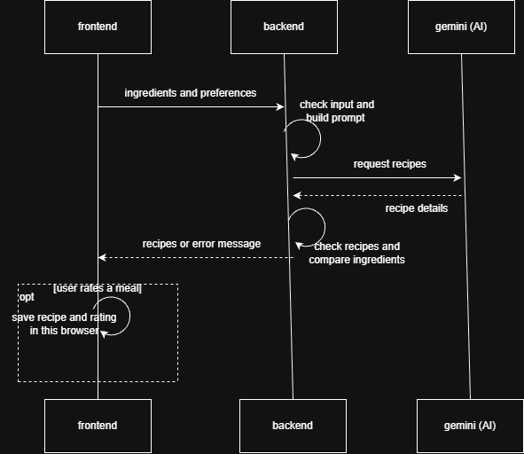

# system architecture

## overview

our ai fridge meal planner has three main parts: a react frontend, a node.js
and express backend, and the google gemini api. the frontend is the webpage
the user interacts with. the backend handles requests and checks recipes.
gemini generates meal ideas from the ingredients and preferences.

## how the parts work together

1. the user enters ingredients, optional expiration dates, a cooking
   time limit, and a dietary preference.
2. the frontend sends this information to the backend using
   `POST /api/recipes`.
3. the backend checks the input and creates a prompt for gemini. the prompt
   includes the ingredients, preferences, and required recipe fields.
4. gemini returns recipe names, ingredients, estimated times, and instructions
   in json, a format our code can read [3].
5. the backend validates the response, removes recipes that fail the time or
   supported dietary checks, and compares ingredients with the user's list.
6. recipes using ingredients expiring within the next week receive an urgency
   boost, with nearer dates weighted more. Ties are sorted by fewer missing
   ingredients. The frontend displays matched and missing ingredients.
7. the user can rate a meal to save it in the browser, change its rating, or
   remove it from saved meals.

## main files

| file | purpose |
| --- | --- |
| `frontend/src/App.jsx` | handles the form, recipe display, and request messages |
| `frontend/src/App.css` | controls the page layout and appearance |
| `backend/server.js` | receives requests, calls gemini, and returns checked recipes |
| `backend/ingredientMatching.js` | compares ingredient names and finds matched and missing ingredients |
| `backend/server.js` | validates recipes and applies the supported vegetarian or vegan checks |

## ai and data

the backend uses `@google/genai`. its default model is
`gemini-3.5-flash-lite`; `GEMINI_MODEL` can change that setting.
gemini creates the recipes. our code handles the form, recipe checks,
ingredient matching, sorting, and ratings.

ingredient names and optional expiration dates come from the user. recipe
ideas come from gemini; the prototype does not use a separate recipe dataset.
Our matching, expiration-priority, and dietary rules are stored in code. Recipes and ratings in
saved meals stay in the same browser and device. clearing browser data
removes them. ratings do not currently change ai recommendations.

the api key is kept in `backend/.env` as `GEMINI_API_KEY`. the backend
uses it to contact google. the key is not included in frontend code or
uploaded to github. ingredients and preferences are sent to google for
recipe generation.

## design choices and limits

we separated the frontend and backend so the webpage handles user interaction
while the backend handles the api key and recipe processing. react state
helps update the page [1], and express routes handle backend requests [2].
the frontend runs at `http://localhost:5173`, and the backend runs at
`http://localhost:3001`.

sorting by missing ingredients helps users find meals that need fewer
additional ingredients. Expiration priority is a simple seven-day ranking
heuristic based on user-entered dates; it does not assess food safety, taste,
or nutrition.

the app needs an internet connection for new recipes. it shows an error
message if a request fails or takes too long. cooking times are ai estimates.
dietary checks recognize a limited set of ingredient names, so some suitable
recipes may be removed. these checks cannot confirm allergy safety.

## references

1. [react: state](https://react.dev/learn/state-a-components-memory)
2. [express: routing](https://expressjs.com/en/guide/routing/)
3. [google: structured outputs](https://aistudio.google.com/docs/structured-output?generate-content=true)
